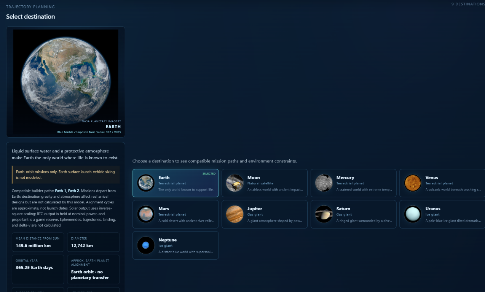
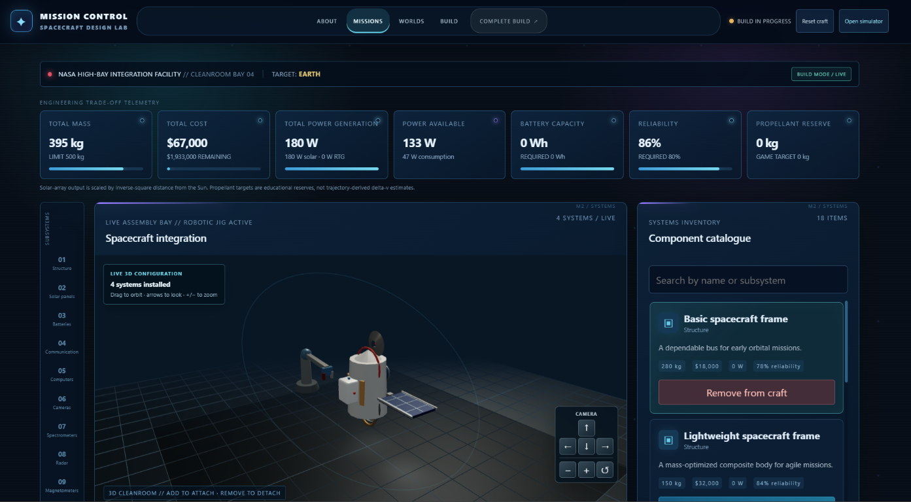
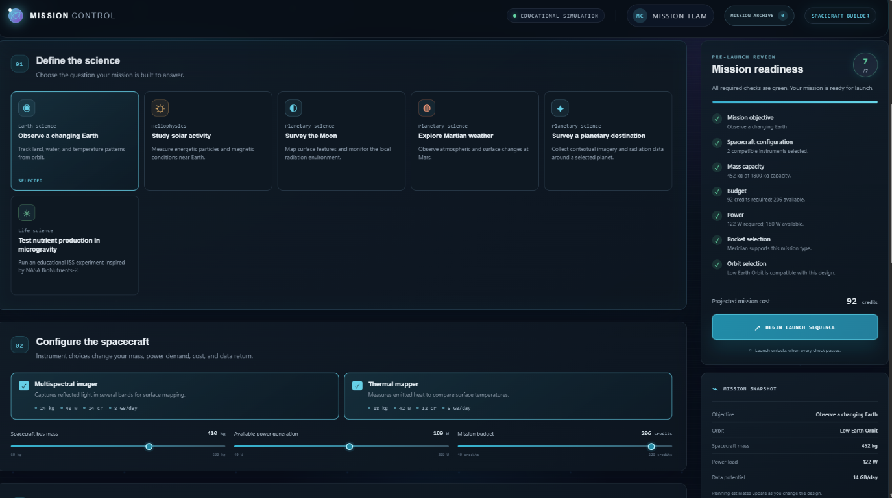
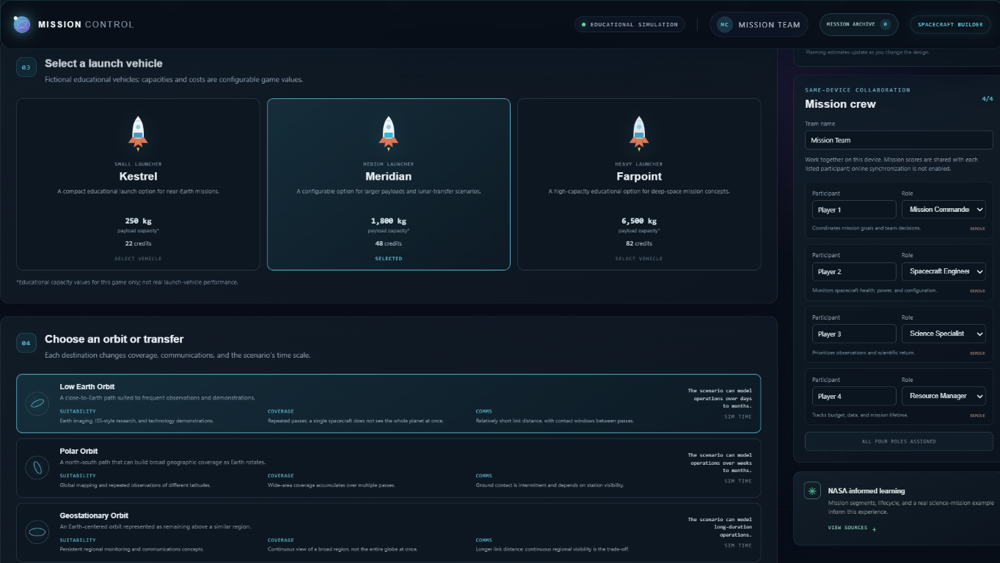
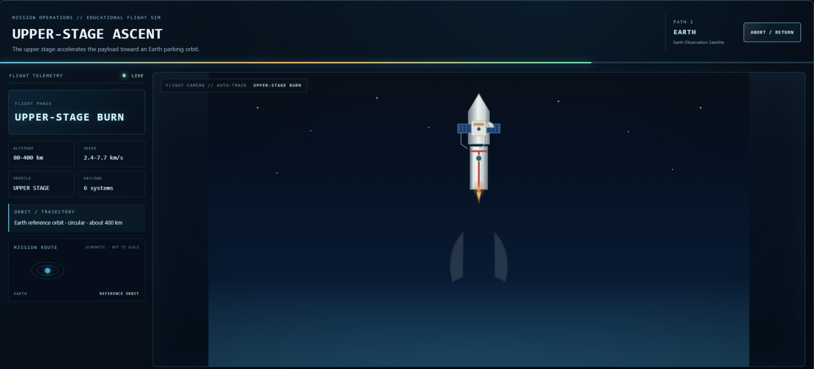
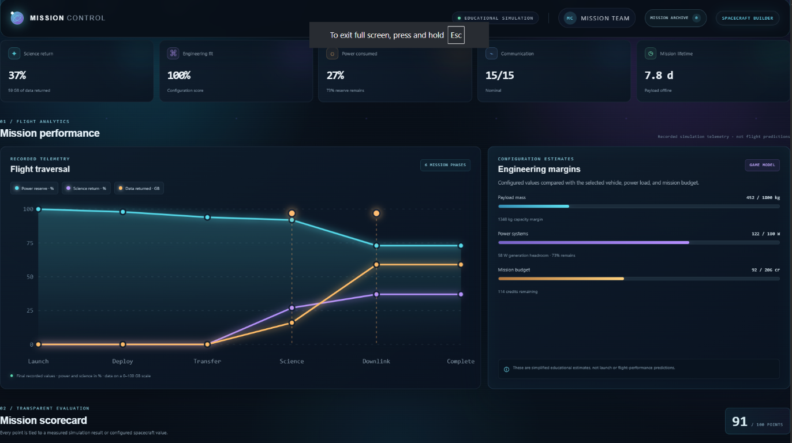

# Mission Control — Spacecraft Design Lab

Mission Control is an educational React game about designing, validating, launching, and evaluating a spacecraft mission. Players choose a destination, select a compatible mission path, assemble subsystems, review resource margins, run an illustrative launch sequence, respond to mission events, and finish with a transparent mission report.

> **Scope note:** This is a learning simulation, not flight-planning software. Trajectories, launch vehicles, delta-v, costs, power values, and mission durations are simplified game estimates unless explicitly identified as measured planetary data.

## What the game teaches

Mission design is a chain of connected engineering decisions:

- A destination changes the environment, communication challenge, and compatible paths.
- Components trade mass, cost, power, reliability, communications, and propulsion reserve.
- Launch readiness is checked before the mission can begin.
- Mission events make the player balance science return against system health.
- The final score explains how the actual simulation outcome earned or lost points.

The design promise is simple: **every number is a decision, and every result is explainable.**

## Five-minute showcase

1. **Start on About** — understand the mission workflow and the eight available paths.
2. **Select a destination** — inspect real solar-system imagery, facts, gravity, atmosphere, and distance.
3. **Choose a compatible path** — select the objective that matches the destination.
4. **Build the spacecraft** — add structure, power, communication, computer, science, and thermal systems.
5. **Review readiness** — verify mass, cost, power, reliability, required systems, rocket, and orbit.
6. **Launch and simulate** — watch countdown, ignition, ascent, deployment, transfer, science, communication, and completion.
7. **Read the report** — inspect telemetry, resource use, score reasons, engineering margins, events, and improvement suggestions.

## Screenshots

### Destination selection

Choose from nine solar-system destinations and compare their visual identity, facts, environment, and compatible paths.



### Spacecraft integration

Assemble a spacecraft in the interactive cleanroom bay. Components can be added and removed while the live resource dashboard updates.



### Mission objective

Select the science question that defines the mission and affects the instrument and resource trade-offs.



### Launch configuration

Choose an educational launch vehicle and orbit profile while the readiness panel checks the design.



### Launch sequence

Follow the illustrative countdown, upper-stage ascent, deployment, transfer, and destination-orbit sequence.



### Mission report

Review the final outcome, score, telemetry graph, resource margins, scorecard, events, and improvement suggestions.



## Mission paths

Paths are engineering challenge templates. The builder filters them after a destination is selected.

| Path | Indicates | Destination focus |
| --- | --- | --- |
| **Path 1** | Earth observation | Observe Earth from a low orbit |
| **Path 2** | Weather monitoring | Track weather systems with reliable imaging and communications |
| **Path 3** | Lunar communications | Extend command and telemetry links around the Moon |
| **Path 4** | Moon exploration | Configure an optical and spectral lunar science mission |
| **Path 5** | Inner planet orbiter | Build an autonomous Mercury, Venus, or Mars orbiter |
| **Path 6** | Asteroid exploration | Inspect a small body; this is an asteroid challenge, not a planet destination |
| **Path 7** | Outer planet survey | Survey Jupiter or Saturn with long-distance communications and power |
| **Path 8** | Ice giant probe | Design a low-sunlight probe for Uranus or Neptune |

## Destinations

The destination selector includes:

- Earth
- Moon
- Mercury
- Venus
- Mars
- Jupiter
- Saturn
- Uranus
- Neptune

Each destination card includes an image, description, distance, gravity, atmosphere context, orbital information, and a clear statement of what the simulation does and does not calculate.

## Scoring and mission report

The scoring engine returns a transparent score out of 100:

| Category | Weight |
| --- | ---: |
| Mission objective achievement | 30 |
| Engineering decisions | 25 |
| Resource efficiency | 20 |
| Communication performance | 15 |
| Mission lifetime management | 10 |

The report includes:

- Mission outcome and final score
- Scientific value and engineering efficiency
- Resource utilization and communications performance
- Mission lifetime and problems encountered
- Telemetry across launch, deployment, transfer, science, downlink, and completion
- Payload, power, and budget margin gauges
- Point-by-point awards and deductions
- Events encountered and decisions taken
- Improvement suggestions
- Save, archive, JSON export, and print/PDF support

Reports are stored locally on the current device. No account or online leaderboard is required.

## NASA and educational resources

NASA references support the educational structure and terminology of the game. They do not mean that the game reproduces NASA vehicles, costs, trajectories, or operational procedures.

### Planetary data and imagery

- [NASA Planetary Fact Sheet](https://nssdc.gsfc.nasa.gov/planetary/factsheet/) — reference values for planetary scale, gravity, orbit, and environment.
- [NASA Science: Moon Facts](https://science.nasa.gov/moon/facts/) — lunar facts and context.
- [NASA Eyes: Solar System](https://eyes.nasa.gov/apps/solar-system/#/home) — optional interactive exploration link from the destination selector.
- [NASA Image and Video Library](https://images.nasa.gov/) — source context for planetary imagery used by the interface.

### Spacecraft and mission-design references

- [Design and Develop Science Missions](https://www.nasa.gov/wp-content/uploads/2025/04/250323-design-and-develop-science-mission.pdf) — mission segments and systems-engineering framing.
- [CubeSat 101](https://www3.nasa.gov/sites/default/files/atoms/files/nasa_csli_cubesat_101_508.pdf) — small-spacecraft design context.
- [NASA Mission Viz](https://github.com/nasa/mission-viz) — mission visualization inspiration.
- [Build It Yourself: Satellite!](https://science.nasa.gov/mission/webb/game-build-it-yourself/) — educational spacecraft-design inspiration.
- [NASA Radioisotope Power Systems](https://science.nasa.gov/planetary-science/programs/radioisotope-power-systems/) — context for deep-space power systems.
- [NASA Small Spacecraft Thermal Control](https://www.nasa.gov/smallsat-institute/sst-soa/thermal-control/) — thermal-management context.
- [NASA 3D Resources](https://github.com/nasa/NASA-3D-Resources) — source collection for optional spacecraft asset references.

The active in-app reference list is maintained in [`src/data/missionCatalog.js`](src/data/missionCatalog.js) and [`src/data/spacecraftData.js`](src/data/spacecraftData.js).

## Technology

- React 19
- Vite
- Tailwind CSS v4 through `@tailwindcss/vite`
- Custom CSS for the Mission Control visual system and motion design
- Three.js
- React Three Fiber and Drei
- Vitest-free Node test runner for focused mission-rule tests

## Run locally

Requirements:

- Node.js with npm
- A modern browser with WebGL support for the enhanced 3D views

```sh
npm install
npm run dev
```

Open the local URL printed by Vite.

Run the focused tests:

```sh
npm test
```

Create a production build:

```sh
npm run build
```

Preview the production build:

```sh
npm run preview
```

## Project structure

```text
src/
├── App.jsx                         # Application flow and Mission Control simulator
├── App.css                         # Global app and simulator styling
├── MissionControl.css              # Builder, launch, report, and responsive styling
├── data/
│   ├── missionCatalog.js           # Objectives, instruments, rockets, orbits, events
│   └── spacecraftData.js           # Destinations, components, paths, and references
├── engine/
│   ├── builderHandoff.js           # Converts builder state into simulator state
│   ├── missionReports.js           # Report creation and local persistence
│   ├── missionRules.js             # Readiness, simulation, events, and mission metrics
│   ├── resourceCalculations.js     # Spacecraft resource validation
│   └── scoring.js                  # Transparent 100-point scoring engine
├── components/
│   ├── SpacecraftIntegrationScene.jsx
│   ├── ThreeMissionScene.jsx
│   ├── LaunchSequence.jsx
│   ├── PlanetSelector.jsx
│   └── MissionVisualization.jsx
├── pages/
│   ├── About.jsx                    # Animated landing page and path guide
│   ├── SpacecraftBuilder.jsx        # Destination-first builder workflow
│   └── MissionSelection.jsx         # Compatible path selection
└── tests/
    └── missionRules.test.js         # Mission-rule and report regression tests
public/
└── images/planets/                  # Local planet imagery used by the selector
docs/
└── screenshots/                     # Documentation screenshots
```

## Architecture

The app has two connected workflows:

### Spacecraft builder

`SpacecraftBuilder` owns component selection, destination selection, path filtering, integration preview, and live resource calculations. The destination is selected first, then compatible mission paths are shown below it.

### Mission Control simulator

The builder handoff creates the simulator design. `missionRules.js` validates readiness, advances the staged simulation, rolls educational mission events, and calculates the final result. `scoring.js` converts measured simulation outcomes and configuration values into the weighted score. `missionReports.js` creates and persists the report record.

### Visualization fallback

Three.js is used where WebGL is available. The mission visualization also has an SVG fallback so the core experience remains usable when enhanced 3D rendering is unavailable.

## Educational limitations

- Rocket specifications, prices, capacities, and mission values are fictional or configurable game values.
- Transfer paths, launch staging, altitude, speed, and destination orbits are illustrative.
- The simulation does not calculate real ephemerides, launch windows, landing trajectories, propulsion performance, or flight-certified delta-v.
- Planet facts and imagery are presented for education and visualization; they are not a substitute for mission analysis.
- NASA names and references are used for educational context only. The project does not use NASA branding to imply endorsement.

## Accessibility and responsive design

- Semantic headings, labels, buttons, and landmarks are used throughout the primary workflow.
- Keyboard-accessible controls are provided for selection and mission actions.
- Reduced-motion preferences disable or minimize decorative animations.
- Builder, launch, and report layouts adapt to tablet and mobile widths.
- The mission report includes textual values alongside visual charts and gauges.

## Credits

- Game code and interface: Mission Control / Spacecraft Design Lab project.
- Planet imagery: credited in the in-app destination data and linked to NASA image/fact resources.
- Educational references: NASA, NASA NSSDC, NASA Science, NASA Small Spacecraft Systems Virtual Institute, and NASA 3D Resources.
- Visual system: original space-themed interface design; no NASA logo or official NASA branding is used.
